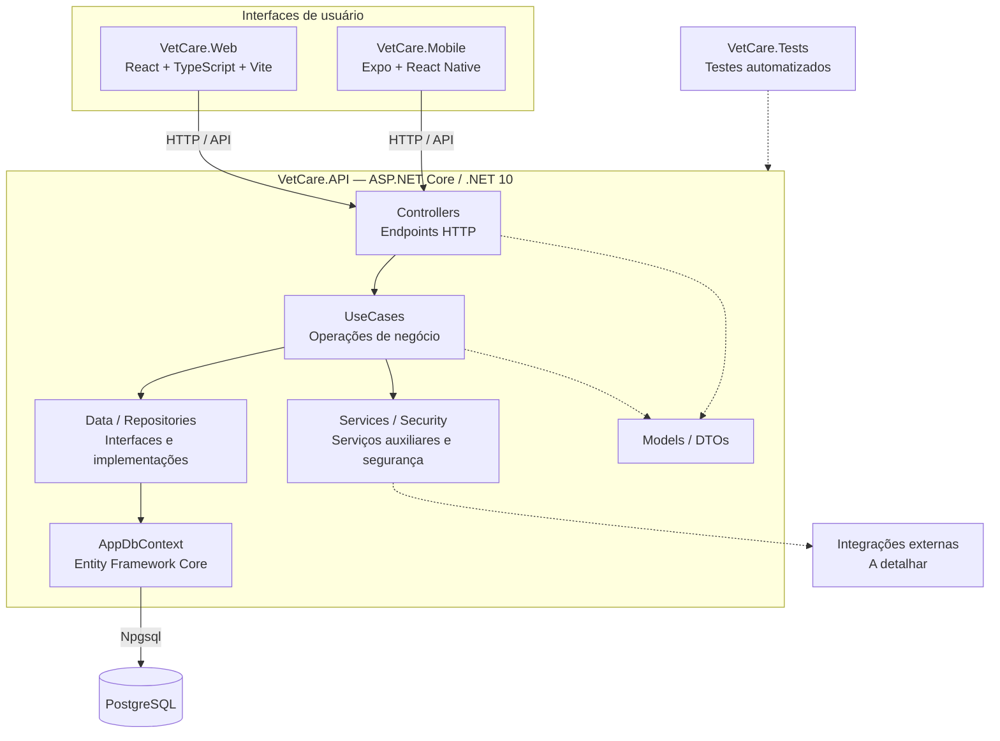

# VetCare — Diagrama de Componentes AS-IS

**Natureza:** engenharia reversa da implementação atual.  
**Situação:** análise estática preliminar; nenhum teste executado.  
**Data:** 23/10/2026.  
**Fonte principal:** https://github.com/Rozeti/ProjetoVetCare

## 1. Objetivo

Representar a organização macro dos componentes encontrados no código do Mateus. **AS-IS** significa *como está atualmente*. Uma arquitetura **TO-BE** será uma proposta futura de alteração, documentada separadamente.

## 2. Diagrama

> **Legenda:** linhas contínuas representam o fluxo arquitetural principal, fundamentado na estrutura e em pontos de código verificados. Linhas tracejadas indicam relações genéricas que precisam de aprofundamento. Este desenho simplifica dependências e não demonstra que todos os fluxos funcionam em execução.

## 3. Evidências identificadas

| Componente | Evidência do código | Conclusão sustentada |
|---|---|---|
| Portal web | `VetCare.Web/package.json`, `src/` | React 19, TypeScript, Vite, componentes, páginas e serviços |
| Aplicativo móvel | `VetCare.Mobile/package.json` | Expo, React Native, React Navigation |
| API | `VetCare.API/VetCare.API.csproj` | Aplicação ASP.NET Core em `net10.0` |
| Controllers | `VetCare.API/Controllers/` | Endpoints organizados por recursos, incluindo usuários, pets e sessões |
| Casos de uso | `VetCare.API/UseCases/` | Operações de autenticação, agenda, usuários, prontuários e outros domínios |
| Repositórios | `VetCare.API/Data/` | Interfaces e implementações de acesso a dados |
| ORM e banco | `AppDbContext.cs`, `Program.cs` | EF Core com `UseNpgsql` configurado para PostgreSQL |
| Testes | `VetCare.Tests/` | Projeto com testes, ainda não executados nesta análise |

### Fluxo real exemplificado — autenticação (HU-001)

1. `UsuariosController.cs` declara `POST api/Usuarios/login`.
2. O controller chama `AutenticarUsuarioUseCase.Executar(LoginDTO)`.
3. Esse caso de uso depende de `IUsuarioRepository`, `PasswordHasher`, `TokenService` e `AuditoriaService`.
4. O projeto configura acesso ao PostgreSQL pelo EF Core em `Program.cs`. Ainda falta detalhar a implementação do repository correspondente.

## 4. Nossa análise em quatro partes

### O que encontramos?

Duas interfaces de usuário, web e mobile, e uma API ASP.NET Core com Controllers, UseCases, Services, Repositories, Models, DTOs e `AppDbContext`. O código declara persistência via PostgreSQL.

### Por que isso importa?

Esse levantamento permite compreender responsabilidades e localizar impactos: uma mudança em autenticação, por exemplo, pode atingir o controller, o caso de uso, a persistência, os contratos da API e as interfaces.

### O que recomendamos?

Validar os fluxos específicos e produzir o diagrama **TO-BE** somente quando houver uma proposta justificada. Não refatorar o código só para torná-lo parecido com um desenho.

### Como explicar à equipe?

> “Mapeamos a implementação atual do VetCare: o portal React e o aplicativo Expo possuem uma API .NET como ponto de integração. Na API, identificamos controllers, casos de uso, serviços, repositórios e o Entity Framework Core conectado ao PostgreSQL. O diagrama representa o que encontramos no repositório; o comportamento ainda precisa ser validado por testes.”

## 5. Pontos pendentes

- Identificar os clientes HTTP e conferir os fluxos reais de web/mobile com a API.
- Inspecionar repositories e migrations para detalhar o banco e os relacionamentos.
- Conferir onde e como arquivos, mídias, notificações e mensagens são tratados.
- Revisar configuração Docker e ambiente de execução.
- Executar testes em ambiente local isolado antes de afirmar conformidade funcional.
- Comparar o desenho AS-IS com os diagramas originais da Arquitetura (páginas 10, 12, 14, 15 e 17).

## 6. Relação com os documentos

Complementa `02-analise-documental/analise-arquitetura.md` e fornece evidências para ARQ-001, ARQ-003, ARQ-004 e ARQ-005. Não altera os três PDFs originais.

## 7. Fontes de inspeção

- `VetCare.API/Program.cs`
- `VetCare.API/VetCare.API.csproj`
- `VetCare.API/Controllers/UsuariosController.cs`
- `VetCare.API/UseCases/AutenticarUsuarioUseCase.cs`
- `VetCare.API/Data/AppDbContext.cs`
- `VetCare.Web/package.json`
- `VetCare.Mobile/package.json`
- Pastas `VetCare.API/{Controllers,UseCases,Services,Data}`, `VetCare.Web/src`, `VetCare.Tests`
- Documento de Arquitetura de Software, versão 4.0 (2026)
