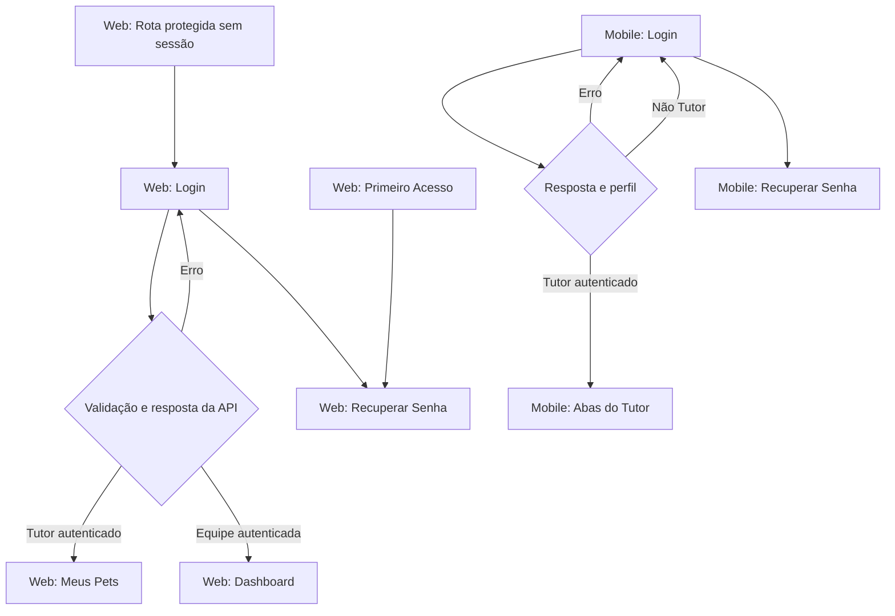

# VetCare — HU-001 | Levantamento preliminar de navegação (AS-IS)

**Data:** 23/10/2026  
**Estado:** inspeção estática do código; não é diagrama de navegação validado em execução.  
**Escopo:** portal web, aplicativo móvel e comparação com o VetCare Lab, sem alterar os três documentos originais.

## 1. O que encontramos?

### 1.1 Portal web — rotas verificadas

- `VetCare.Web/src/pages/Login.tsx`: formulário de login; valida campos obrigatórios e formato de e-mail; chama `entrar(email, senha)`; apresenta mensagens devolvidas pela API; fornece acesso à recuperação de senha.
- `VetCare.Web/src/App.tsx`: declara as rotas `/login`, `/recuperar-senha` e `/primeiro-acesso` como públicas.
- `App.tsx`, componente `Protegida`: sem usuário autenticado, redireciona à rota `/login`; perfil não autorizado para uma rota é enviado à página inicial adequada ao perfil, em vez de visualizar essa rota.
- `App.tsx`, `PaginaInicial`: perfil `Tutor` é redirecionado a `/meus-pets`; outros perfis apresentam `Dashboard` em `/`.
- `VetCare.Web/src/contexts/AuthContext.tsx`: `entrar` envia `POST /api/usuarios/login`, armazena a resposta e define o usuário; `sair` limpa a sessão local; na inicialização revalida a sessão persistida com `GET /api/usuarios/me`.
- `VetCare.Web/src/services/api.ts`: interceptador anexa o token às requisições e trata algumas recusas de sessão; `401` de uma chamada de login não deve provocar redirecionamento automático indevido.

**Fluxo principal identificado:** Login → validação → resposta da API → [erro: permanece na tela] / [sucesso da equipe: `/`] / [sucesso Tutor: `/meus-pets`].

**Fluxos auxiliares relevantes:** Login → Recuperar senha; Primeiro acesso → RecuperarSenha em modo especial; Rota protegida sem sessão → Login; Logout → estado sem usuário (a confirmação do destino concreto envolve inspecionar o Layout e/ou testar).

### 1.2 Aplicativo móvel — telas verificadas

- `VetCare.Mobile/src/telas/Login.tsx`: tela de login, acesso à recuperação de senha e mensagens de falha.
- `VetCare.Mobile/src/contextos/AuthContext.tsx`: chama o mesmo endpoint; **somente o perfil `Tutor` é aceito pelo aplicativo**; persiste sessão com `AsyncStorage`; tenta revalidar sessão com `/api/usuarios/me`.
- `VetCare.Mobile/src/Navegacao.tsx`: sem usuário há uma pilha Login/RecuperarSenha; com usuário há a área principal com abas (`MeusPets`, `MinhaAgenda`, `Mensagens`, `Notificacoes`, `Perfil`) e a tela `Prontuario`.
- `VetCare.Mobile/src/navegacao/rotas.ts`: define os nomes das telas e o mapeamento de links de notificações para destinos do aplicativo.

**Fluxo principal identificado:** Login → resposta da API → [erro: permanece no login] / [perfil não Tutor: mensagem e não persiste sessão] / [Tutor: área principal]. A navegação muda automaticamente de pilha quando o estado de usuário muda.

### 1.3 Nosso VetCare Lab

Em `07-laboratorio-web/js/app.js`, o laboratório alterna na mesma página entre `#login-view` e `#dashboard-view`. Ele simula credenciais fictícias, quatro perfis e logout. **Não implementa** as rotas reais do portal ou mobile, nem autenticação via API.

## 2. Por que isso importa?

Um **diagrama de sequência** mostra interação entre componentes; um **diagrama de navegação** mostra as telas, os caminhos de acesso, decisões e retornos. Não devemos inferir telas reais a partir da lista de funcionalidades demonstrativas do Lab.

Os fluxos de autenticação **são distintos por cliente**: a API pode autenticar um usuário da equipe, mas o aplicativo móvel não permite prosseguir com esse perfil. Também existe a via de recuperação de senha e primeiro acesso, que não aparece na simulação atual.

## 3. O que recomendamos?

1. **Registrar esta inspeção como levantamento AS-IS**, ainda sem marcar o fluxo completo como validado.
2. Inspecionar a navegação acionada pelos menus e pelo logout em `VetCare.Web/src/components/Layout.tsx` e na tela mobile `Perfil.tsx`, incluindo casos de perda de sessão.
3. Inspecionar o comportamento de `RecuperarSenha.tsx` no web/mobile e os endpoints correspondentes, antes de consolidar setas de retorno e estados.
4. Preparar posteriormente **dois diagramas de navegação do código original** (web e mobile), com referência cruzada à HU-001; se útil, um terceiro diagrama curto apenas do VetCare Lab como protótipo.
5. Confrontar os diagramas com os critérios de aceite do Documento de Requisitos original, sem tratar divergência documental como bug automaticamente.
6. Manter CT-AUT-001/002/003 aprovados **apenas no Lab** e CT-AUT-006 limitado à apresentação de perfis; nenhum teste do sistema oficial foi executado.

## 4. Como explicar à equipe?

> “A HU-001 possui um fluxo de entrada e também caminhos de recuperação, restauração de sessão, logout e redirecionamento conforme o perfil. A equipe usa o portal; no aplicativo, o acesso é restrito ao Tutor. Estamos levantando essas transições diretamente do código existente para desenhar a navegação real, sem confundir o simulador do laboratório com o VetCare oficial. Ainda falta confirmar alguns retornos antes de fechar o diagrama.”

## 5. Mapa preliminar — para investigação, não homologação

**Nota:** o fluxograma é uma representação **preliminar de alto nível**. Não inclui ainda setas de retorno de recuperação, logout e perda de sessão porque serão verificadas especificamente. Não substitui o diagrama de navegação completo desejado para o TCC.

## 6. Referências de código

- `Rozeti/ProjetoVetCare/VetCare.Web/src/App.tsx`
- `Rozeti/ProjetoVetCare/VetCare.Web/src/pages/Login.tsx`
- `Rozeti/ProjetoVetCare/VetCare.Web/src/contexts/AuthContext.tsx`
- `Rozeti/ProjetoVetCare/VetCare.Web/src/services/api.ts`
- `Rozeti/ProjetoVetCare/VetCare.Mobile/src/Navegacao.tsx`
- `Rozeti/ProjetoVetCare/VetCare.Mobile/src/navegacao/rotas.ts`
- `Rozeti/ProjetoVetCare/VetCare.Mobile/src/telas/Login.tsx`
- `Rozeti/ProjetoVetCare/VetCare.Mobile/src/contextos/AuthContext.tsx`
- `alineopinho/vetcare-engenharia-software/07-laboratorio-web/js/app.js`
- `alineopinho/vetcare-engenharia-software/05-testes/execucoes/registro-execucao-hu-001-lab.md`
