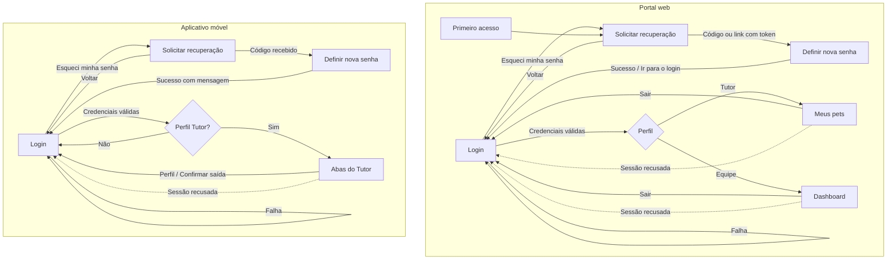

# VetCare — HU-001 | Complemento ao levantamento de navegação AS-IS

**Data:** 23/10/2026  
**Status:** inspeção estática concluída para os caminhos principais; execução do sistema original pendente.  
**Escopo:** recuperação e primeiro acesso, logout e perda de sessão no código `Rozeti/ProjetoVetCare`.  
**Relação:** complementar `04-diagramas/navegacao/levantamento-navegacao-hu-001-as-is.md`; não substituir os três PDFs originais.

## 1. O que encontramos?

### 1.1 Recuperação de senha e primeiro acesso no portal web

- `VetCare.Web/src/App.tsx` declara `/recuperar-senha` e `/primeiro-acesso`; ambas usam `RecuperarSenha.tsx`, sendo a segunda no modo `primeiroAcesso`.
- O formulário permite solicitar instruções com e-mail (`POST /api/usuarios/recuperar-senha`). Após isso, a pessoa pode redefinir a senha com **token no link** ou **e-mail + código de seis dígitos** (`POST /api/usuarios/redefinir-senha`).
- O componente verifica localmente formato do e-mail, tamanho mínimo da senha, confirmação e formato do código quando aplicável. Após sucesso, apresenta um link explícito **Ir para o login**. Também disponibiliza **Voltar para o login** durante o processo.
- O servidor executa a recuperação em `RecuperarSenhaUseCase`: resposta neutra na solicitação, verificação de validade do pedido e senha, marcação do token como utilizado e limpeza de bloqueio de tentativas quando a redefinição é concluída.

### 1.2 Recuperação de senha no aplicativo

- `VetCare.Mobile/src/Navegacao.tsx` define a pilha pública `Login` / `RecuperarSenha`.
- `VetCare.Mobile/src/telas/RecuperarSenha.tsx` permite solicitar instruções, informar o **código de seis dígitos** e definir a nova senha. Após sucesso, navega de volta a `Login` com uma mensagem de confirmação.
- A tela contém retorno para login e opção de solicitar novo código.

### 1.3 Logout

- **Web:** `VetCare.Web/src/components/Layout.tsx` define `aoSair()`, que chama `sair()` do contexto e navega para `/login`. `AuthContext.tsx` limpa token e usuário do `localStorage`.
- **Mobile:** `VetCare.Mobile/src/telas/Perfil.tsx` apresenta confirmação de saída. Após confirmar, `AuthContext.sair` tenta remover o registro do dispositivo para notificações, limpa o `AsyncStorage` e zera o usuário; `Navegacao.tsx` então volta à pilha pública quando o estado não contém usuário.
- **Limite técnico:** remoção da sessão no cliente não prova revogação imediata de JWT no servidor.

### 1.4 Perda e restauração de sessão

- **Web:** `AuthContext.tsx` tenta revalidar a sessão restaurada via `GET /api/usuarios/me`; em resposta recusada (401/403), limpa a sessão. `services/api.ts` também trata 401 em requisições protegidas, evitando interpretar um login incorreto como expiração de sessão. Uma falha de rede, por si só, não deve apagar a sessão salva.
- **Mobile:** `AuthContext.tsx` lê token e usuário do `AsyncStorage` e revalida em `/api/usuarios/me`. O interceptor em `services/api.ts` limpa o armazenamento e dispara o retorno à navegação pública quando recebe 401 em rota não pública; o contexto também contempla recusa 401/403 durante a restauração. Falha de rede não é equiparada automaticamente a uma recusa de autenticação.
- **Ponto para teste posterior:** verificar em execução a consistência do tratamento de 401 e 403 entre interceptores, contextos e telas.

## 2. Mapa de navegação identificado (não homologado)

**Legenda:** setas contínuas = transições previstas nas rotas/funções inspecionadas; setas tracejadas = comportamento de perda de sessão cuja experiência completa ainda exige teste de execução. O desenho abstrai condições de erro dentro da recuperação e detalhes de notificações.

## 3. Por que isso importa?

- Completa os ramos de **entrada, recuperação, saída e reentrada** da autenticação, não só o login bem-sucedido.
- Distingue **páginas web** de **telas mobile**, com navegações e públicos diferentes.
- Permite revisar requisitos e critérios de aceite sem confundir um caminho identificado no código com um comportamento efetivamente testado.

## 4. O que recomendamos?

1. Usar este complemento para revisar o levantamento preliminar já existente, sem sobrescrevê-lo automaticamente.
2. Confrontar primeiro acesso e recuperação de senha com o Documento de Requisitos, verificando se há regras ausentes ou mudanças de escopo.
3. Posteriormente gerar os **diagramas consolidados separados** de navegação web e mobile, após revisão das transições e tratamento de falhas.
4. Manter os testes do sistema oficial como **não executados**. No VetCare Lab, não simular JWT, código de recuperação e bloqueio sem uma decisão específica de escopo.
5. Abrir análise de divergência apenas se requisitos e comportamento implementado realmente não coincidirem; diferenças não são defeitos automáticos.

## 5. Como explicar à equipe?

> “Terminamos o levantamento estático dos caminhos de autenticação: login, recuperação e primeiro acesso, saída e perda de sessão. No portal, primeiro acesso e recuperação compartilham o componente; no mobile a redefinição usa código e volta ao login. A sessão pode ser restaurada e revalidada pela API. O fluxo já pode ser desenhado de forma preliminar, mas precisamos de execução do sistema real para validá-lo.”

## 6. Fontes examinadas

- `VetCare.Web/src/App.tsx`
- `VetCare.Web/src/pages/RecuperarSenha.tsx`
- `VetCare.Web/src/components/Layout.tsx`
- `VetCare.Web/src/contexts/AuthContext.tsx`
- `VetCare.Web/src/services/api.ts`
- `VetCare.Mobile/src/Navegacao.tsx`
- `VetCare.Mobile/src/telas/RecuperarSenha.tsx`
- `VetCare.Mobile/src/telas/Perfil.tsx`
- `VetCare.Mobile/src/contextos/AuthContext.tsx`
- `VetCare.Mobile/src/services/api.ts`
- `VetCare.API/UseCases/RecuperarSenhaUseCase.cs`

**Observação:** análise do código disponível no repositório original, sem alteração de arquivos nem teste de execução.
