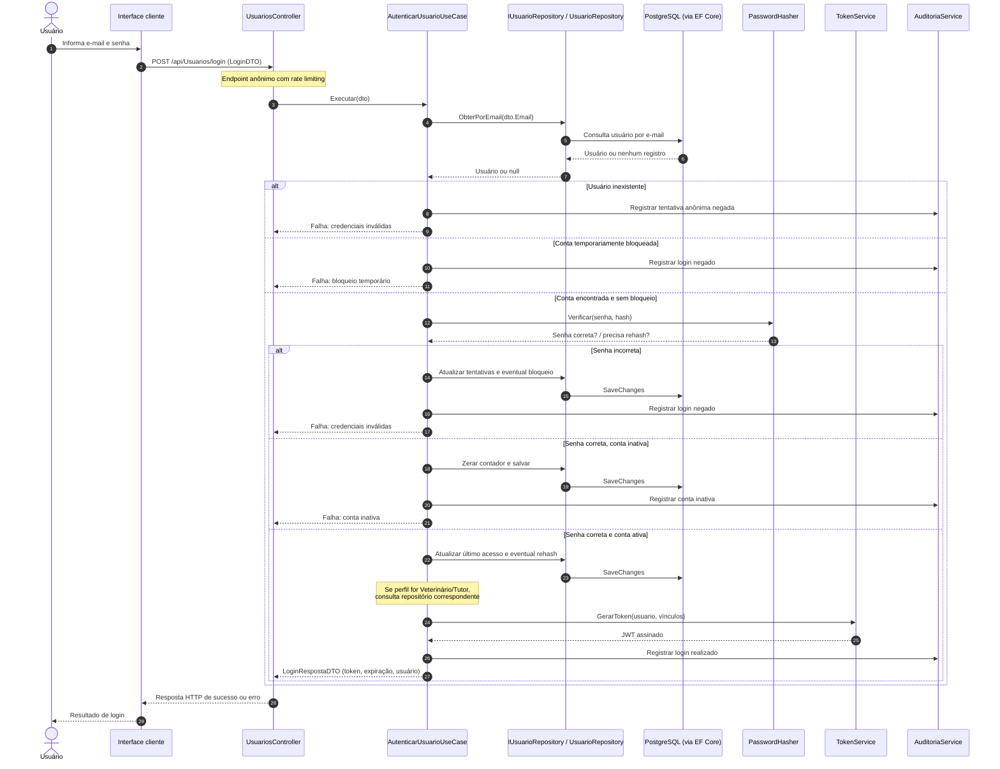

# VetCare — HU-001: Autenticar usuário (AS-IS)

**Data da análise:** 23/10/2026  
**Estado:** análise estática do código; execução ainda não realizada  
**Origem:** `Rozeti/ProjetoVetCare` e Documento de Requisitos de Software, 18/06/2026, pp. 5 e 16–18.

## 1. Objetivo e escopo

Representar o comportamento **já escrito** na API para a HU-001. Este documento não substitui a especificação original e não atesta execução bem-sucedida. O comportamento do portal React após receber a resposta será inspecionado separadamente.

## 2. Diagrama de sequência — login

> **Atenção:** o diagrama combina diferentes caminhos em uma única representação para fins didáticos. Os status HTTP exatos de todas as falhas devem ser confrontados com `Resultado<T>` e seus mapeadores antes de documentar contratos da API.

## 3. Entendendo a análise em quatro partes

### 3.1 O que encontramos?

- `UsuariosController.cs` declara `POST /api/Usuarios/login`, com `[AllowAnonymous]` e `[EnableRateLimiting(...)]`.
- `AutenticarUsuarioUseCase.cs` consulta `IUsuarioRepository.ObterPorEmail`, utiliza `PasswordHasher`, controla tentativas e chama `TokenService` quando autoriza acesso.
- `UsuarioRepository.cs` usa `AppDbContext` e Entity Framework Core para buscar o usuário e salvar alterações.
- `TokenService.cs` emite JWT com identificação, perfil e clínica (`ClinicaId`), além de vínculos de Veterinário ou Tutor quando aplicáveis.
- Cinco senhas incorretas consecutivas causam bloqueio por **15 minutos** na implementação atual.

### 3.2 Por que isso importa?

A separação permite investigar, em cada camada, responsabilidades diferentes: HTTP no controller, regras de autenticação no caso de uso, persistência no repository, verificação de senha no hasher e emissão de credenciais no token service. Para testar a HU-001, precisamos cobrir tanto o percurso de sucesso quanto os caminhos negados e os limites de acesso.

### 3.3 O que recomendamos?

1. **Manter a arquitetura AS-IS como referência:** ainda não há justificativa demonstrada para refatorar esse fluxo.
2. **Validar por testes:** login válido; usuário inexistente; senha errada; quinto erro; bloqueio vigente; conta inativa; perfil e clínica no token; expiração; logout e sessão no cliente.
3. **Revisar a especificação da HU-001:** a regra RN-006 fala em bloqueio temporário; registrar os 15 minutos como decisão concreta da implementação, sujeita a validação.
4. **Inspecionar o React e o mobile:** a navegação por perfil e o logout estão previstos na HU-001, mas não foram verificados nesta análise do back-end.
5. **No VetCare Lab:** demonstrar cenários com dados fictícios e sinalização clara de simulação; nunca apresentar login em JavaScript estático como autenticação segura.

### 3.4 Como explicar à equipe?

> “Mapeamos o login desde o controller até a consulta ao usuário, verificação da senha e emissão do JWT. O código diferencia acessos válidos de credenciais inválidas, contas inativas e bloqueios temporários. Agora precisamos testar esses cenários e verificar a navegação e o logout nos clientes web e mobile antes de afirmar conformidade completa com a HU-001.”

## 4. Rastreabilidade inicial

| Origem | Exigência | Evidência estática | Validação pendente |
| --- | --- | --- | --- |
| HU-001 CA1 | Login válido acessa painel do perfil | LoginResponse contém usuário e token | Redirecionamento no cliente e autorização efetiva |
| HU-001 CA2 | Credenciais inválidas exibem mensagem genérica | `MensagemCredenciaisInvalidas` | Testes HTTP e UI |
| HU-001 CA3 | Logout encerra sessão | Não verificado nos arquivos inspecionados | Código web/mobile e possível revogação de credenciais |
| HU-001 CA4 + RN-006 | Bloqueio após cinco erros | `MaximoTentativas = 5`; `DuracaoBloqueio = 15 minutos` | Testes consecutivos e desbloqueio |
| RN-005 / RNF-002 | Controle de acesso por perfil | JWT inclui `ClaimTypes.Role` e `ClinicaId` | Endpoints protegidos e isolamento de tenant |

## 5. Itens abertos para a próxima inspeção

- Mapear a tela e o serviço de login no React e a autenticação do aplicativo Expo.
- Conferir o significado exato de `Resultado<T>` e os códigos HTTP das falhas.
- Verificar como expiração, armazenamento, descarte de token e logout funcionam no cliente.
- Executar os testes existentes e registrar evidências; nenhum teste foi executado aqui.

## 6. Fontes conferidas

**Documentação:** Documento de Requisitos de Software, seção 3 (HU-001), seção 4 (RN-005, RN-006), seção 5 (RNF-002) e seção 6 (matriz de rastreabilidade).  
**Código:**

- [`UsuariosController.cs`](https://github.com/Rozeti/ProjetoVetCare/blob/main/VetCare.API/Controllers/UsuariosController.cs)
- [`AutenticarUsuarioUseCase.cs`](https://github.com/Rozeti/ProjetoVetCare/blob/main/VetCare.API/UseCases/AutenticarUsuarioUseCase.cs)
- [`UsuarioRepository.cs`](https://github.com/Rozeti/ProjetoVetCare/blob/main/VetCare.API/Data/UsuarioRepository.cs)
- [`TokenService.cs`](https://github.com/Rozeti/ProjetoVetCare/blob/main/VetCare.API/Security/TokenService.cs)

**Relação:** complementa `04-diagramas/componentes/diagrama-componentes-as-is.md` e `02-analise-documental/analise-arquitetura.md`.
