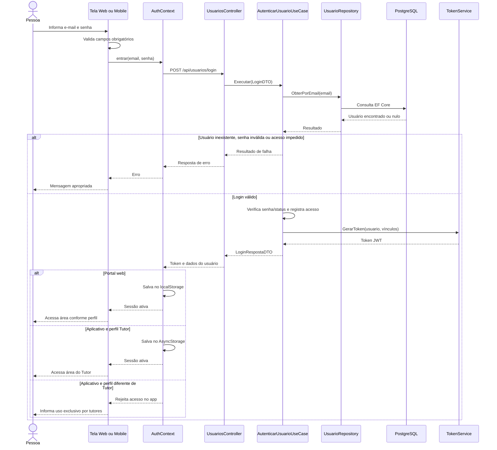

# HU-001 — Login no portal web e no aplicativo (AS-IS)

**Projeto:** VetCare — Engenharia de Software  
**Referência:** inspeção estática do repositório `Rozeti/ProjetoVetCare`, 23/10/2026  
**Estado:** código analisado, comportamento ainda não testado em execução.

## 1. O que encontramos?

O portal web (React/TypeScript) utiliza o mesmo endpoint de autenticação que o aplicativo mobile (Expo/React Native): `POST /api/usuarios/login`. A diferença é que o aplicativo móvel aceita **somente o perfil Tutor**, enquanto o portal atende aos perfis da aplicação.

O diagrama representa o caminho principal encontrado no código e **simplifica chamadas auxiliares**, como auditoria e persistência de alterações. Não equivale a evidência de execução.

**Verificações específicas:**

- **Web:** `Login.tsx` valida campos e formato do e-mail; `AuthContext.tsx` envia as credenciais, guarda token e usuário em `localStorage`, restaura e revalida a sessão com `/api/usuarios/me` e faz logout local.
- **Mobile:** `Login.tsx` valida os campos; `AuthContext.tsx` utiliza `AsyncStorage`, revalida a sessão com `/api/usuarios/me` e rejeita o login quando `perfil != 'Tutor'`.
- **API:** `UsuariosController.Login` chama `AutenticarUsuarioUseCase.Executar`. O caso de uso consulta `IUsuarioRepository`, verifica a senha, bloqueia a conta após cinco falhas por 15 minutos e emite JWT usando `TokenService` quando autorizado.

## 2. Por que isso importa?

As interfaces têm **públicos e regras de navegação diferentes**, apesar de usar a mesma API. Documentar “um login para todos” sem distinguir a restrição mobile pode gerar testes incompletos. Além disso, armazenamento local de token, expiração de sessão e revalidação são aspectos de segurança que precisam de verificação própria.

## 3. O que recomendamos?

1. Registrar a distinção **portal para os perfis da clínica / aplicativo exclusivo para tutores** na proposta do Documento de Requisitos.
2. Preparar testes para login válido, credenciais inválidas, usuário inativo, bloqueio após cinco tentativas, logout, token expirado e rede indisponível.
3. Revisar a estratégia de armazenamento do JWT em cada cliente como **ponto de avaliação**, sem afirmar que existe vulnerabilidade comprovada.
4. No futuro mini site, criar primeiro um **fluxo simulado com dados fictícios**, sinalizado como demonstração; conectar à API somente em ambiente experimental.

## 4. Como explicar à equipe?

> Analisamos como a autenticação funciona nos dois clientes do VetCare. Ambos consultam a mesma API ASP.NET Core, mas o portal atende aos perfis da clínica e o aplicativo é restrito a tutores. Identificamos mecanismos de token, revalidação de sessão e bloqueio de tentativas no código. Nossa proposta é registrar essas distinções nos requisitos e validar o comportamento com testes antes de sugerir mudanças.

## 5. Rastreabilidade

| Referência | Evidência | Estado |
| --- | --- | --- |
| HU-001 — autenticação | Controllers, telas e contextos de autenticação | Identificado no código |
| HU-001 — credenciais inválidas | UseCase e mensagens das telas | Teste pendente |
| HU-001 — logout | Métodos `sair` em ambos os contextos | Teste pendente |
| RN-005 — controle de acesso | Perfil Tutor no mobile, perfis na API | Auditoria integral pendente |
| RN-006 — tentativas | 5 tentativas e bloqueio por 15 minutos no UseCase | Teste pendente |
| RNF-002 — segurança | JWT, interceptor e revalidação | Avaliação de segurança pendente |

## 6. Fontes consultadas

- `VetCare.Web/src/pages/Login.tsx`
- `VetCare.Web/src/contexts/AuthContext.tsx`
- `VetCare.Web/src/services/api.ts`
- `VetCare.Mobile/src/telas/Login.tsx`
- `VetCare.Mobile/src/contextos/AuthContext.tsx`
- `VetCare.Mobile/src/services/api.ts`
- `VetCare.API/Controllers/UsuariosController.cs`
- `VetCare.API/UseCases/AutenticarUsuarioUseCase.cs`
- `VetCare.API/Data/UsuarioRepository.cs`
- `VetCare.API/Security/TokenService.cs`
- Documento de Requisitos de Software, 18/06/2026: HU-001, RN-005, RN-006, RNF-002.

**Próximo passo:** derivar os cenários de teste de HU-001 e especificar o fluxo demonstrativo do VetCare Lab.
