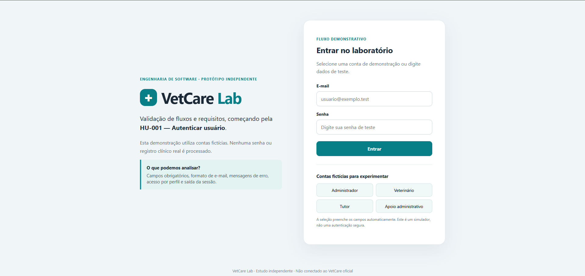
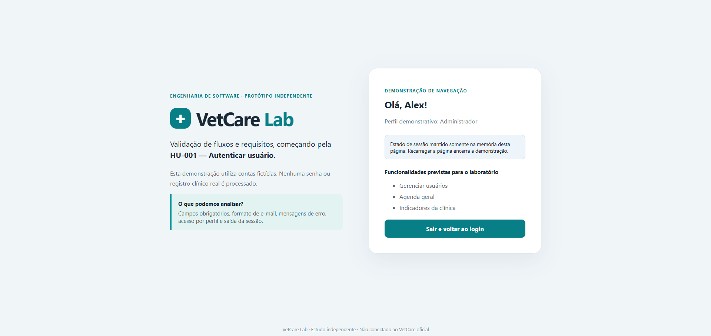
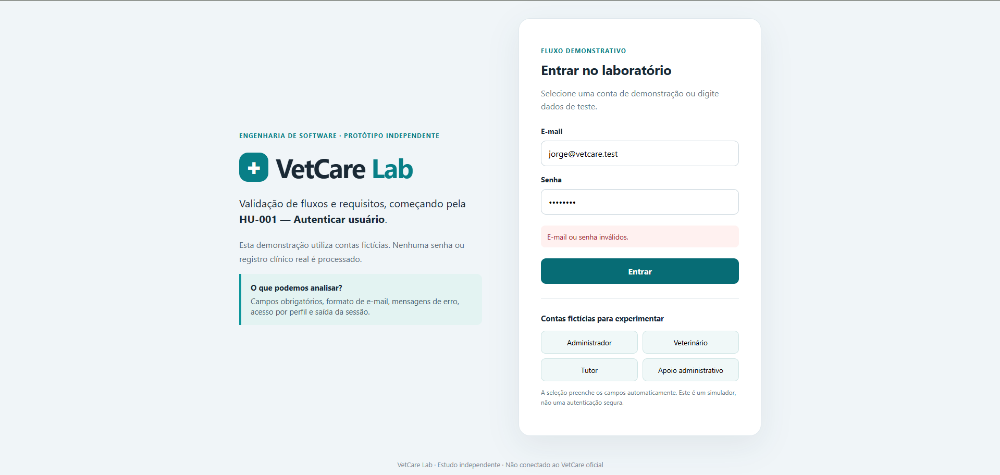
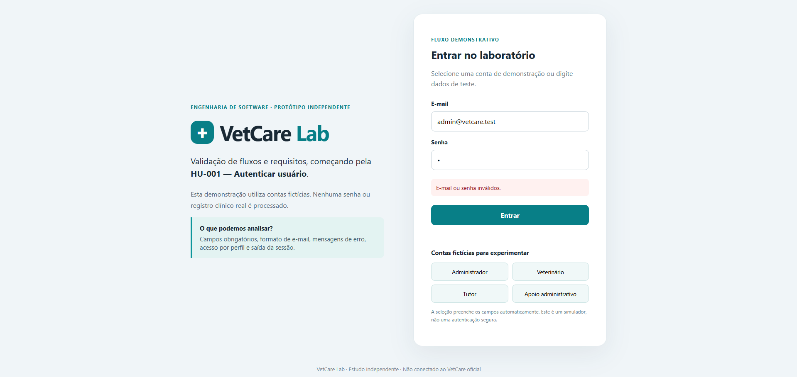

# VetCare Lab — Registro de execução manual da HU-001

**Data do registro:** 23/10/2026  
**Ambiente:** VetCare Lab local (`07-laboratorio-web/`), HTML/CSS/JavaScript, navegador não informado  
**Origem da evidência:** relatos de execução manual e capturas de tela produzidas pela responsável pelo laboratório  
**Escopo:** protótipo independente. **Não é evidência de teste da API, do banco de dados ou do sistema oficial.**

## CT-AUT-001 — Login válido e exibição do perfil

- **Objetivo:** verificar se, após informar credenciais fictícias válidas, o laboratório exibe o painel e o perfil correspondente.
- **Procedimento relatado:** selecionar e entrar com os perfis demonstrativos disponíveis no laboratório.
- **Esperado:** exibir a interface de demonstração correspondente ao usuário escolhido, sem apresentar erro de autenticação.
- **Observado:** o login foi realizado sem erros; os perfis demonstrativos apareceram corretamente ao selecionar as diferentes contas.
- **Resultado:** **Aprovado no laboratório (execução manual relatada).**
- **Evidências:** relato da execução manual e duas capturas de tela.

  **Evidência 01 — Tela de login**

  

  **Evidência 02 — Perfil Administrador**

  

- **Limitação:** este registro não comprova autenticação na API ASP.NET Core, autorização de endpoints nem sessão JWT.

## VAL-HU001-001 — Validação de campos obrigatórios (verificação complementar)

- **Objetivo:** confirmar a mensagem de erro ao enviar o formulário com campos obrigatórios vazios.
- **Procedimento relatado:** clicar em **Entrar** sem preencher os campos.
- **Esperado:** impedir o avanço e mostrar mensagem de orientação.
- **Observado:** a interface exibiu `Informe o e-mail e a senha para entrar.`
- **Resultado:** **Aprovado no laboratório (execução manual relatada).**
- **Rastreabilidade:** complemento de validação de entrada da HU-001; **não equivale** à verificação de credenciais incorretas do CT-AUT-002.

## CT-AUT-002 — Credenciais inválidas

- **Objetivo:** verificar se o laboratório recusa credenciais inválidas sem permitir acesso ao painel demonstrativo.
- **Procedimento relatado:** (1) tentar login com endereço de e-mail inexistente; (2) selecionar a conta Administrador e informar senha incorreta.
- **Esperado:** exibir `E-mail ou senha inválidos.` nas duas tentativas e permanecer na tela de login.
- **Observado:** conforme relato da execução manual, as duas tentativas foram recusadas, com apresentação da mensagem esperada e sem acesso ao painel.
- **Resultado:** **Aprovado no laboratório (execução manual relatada).**
- **Evidências:** duas capturas informadas pela responsável pelo laboratório.

  **Evidência 01 — E-mail inexistente**

  

  **Evidência 02 — Senha incorreta**

  

- **Limitação:** o resultado é restrito à validação demonstrativa no navegador; não comprova comportamento da API oficial nem segurança da autenticação.

## CT-AUT-003 — Logout e retorno ao login

- **Objetivo:** verificar se a ação de sair encerra a sessão demonstrativa, retorna à tela de login e limpa os campos do formulário.
- **Procedimento relatado:** entrar como Administrador; acionar **Sair e voltar ao login**; conferir os campos; atualizar a página.
- **Esperado:** ocultar o painel, mostrar novamente o formulário de login com e-mail e senha vazios; ao atualizar a página, não restaurar a sessão demonstrativa.
- **Observado:** ao sair da conta de Administrador, a tela de login reapareceu com os campos vazios. Após atualizar a página, os campos permaneceram vazios e não houve relato de restauração do painel.
- **Resultado:** **Aprovado no laboratório (execução manual relatada).**
- **Evidência:** relato textual da execução manual em 23/10/2026. **Captura de tela ainda não anexada.**
- **Limitação:** esse comportamento corresponde à sessão simulada em memória no VetCare Lab; não verifica revogação de JWT nem logout na API do sistema oficial.

## CT-AUT-006 — Apresentação demonstrativa por perfil (verificação parcial)

- **Objetivo:** verificar se o VetCare Lab apresenta a lista demonstrativa de funcionalidades correspondente a cada perfil selecionado.
- **Procedimento relatado:** entrar sucessivamente com as contas fictícias de Administrador, Veterinário, Tutor e Apoio Administrativo, observando o painel apresentado em cada login.
- **Esperado no laboratório:** exibir o nome e o perfil corretos, com a lista de funcionalidades demonstrativas associada à conta utilizada.
- **Observado:** todos os perfis apresentaram as respectivas funcionalidades conforme o esperado; nenhuma divergência foi relatada.
- **Resultado da verificação de interface:** **Aprovado no laboratório (execução manual relatada).**
- **Situação do CT-AUT-006 completo:** **Parcialmente verificado.** O plano exige também verificar controle de autorização por perfil, incluindo tentativas de acesso não autorizado na API; esse comportamento não é implementado nem comprovado pelo simulador.
- **Evidência:** relato textual da execução manual em 23/10/2026. Capturas de tela específicas deste cenário não foram anexadas.
- **Limitação:** listas demonstrativas de funcionalidades não são controle de acesso; não comprovam restrições de rotas, permissões ou autorização no back-end do Mateus.

## Situação dos demais testes

| Teste | Situação no sistema oficial | Situação no laboratório |
| --- | --- | --- |
| CT-AUT-001 — Login válido | Não executado | Aprovado (relato manual e imagens) |
| CT-AUT-002 — Credenciais inválidas | Não executado | Aprovado (relato manual e imagens) |
| CT-AUT-003 — Logout | Não executado | Aprovado (relato manual; print pendente) |
| CT-AUT-004 — Bloqueio por tentativas | Não executado | Não implementado |
| CT-AUT-005 — Conta inativa | Não executado | Não implementado |
| CT-AUT-006 — Acesso por perfil | Não executado | Verificação de apresentação aprovada; caso completo parcialmente verificado, autorização não testada |
| CT-AUT-007 — Sessão inválida/expirada | Não executado | Não implementado |
| CT-AUT-008 — Mobile exclusivo Tutor | Não executado | Fora do escopo do laboratório atual |

## Análise de Engenharia de Software

### O que encontramos?

No VetCare Lab, foram executados manualmente login com contas fictícias, validação de campos obrigatórios, duas tentativas de credenciais incorretas, logout demonstrativo e apresentação das funcionalidades dos quatro perfis. Os comportamentos observados foram relatados como esperados. Os CT-AUT-001 e CT-AUT-002 possuem referências a capturas de tela; para o CT-AUT-003, a evidência é textual até a inclusão de imagem. O código do laboratório está em `07-laboratorio-web/js/app.js` e `index.html`.

### Por que isso importa?

Os resultados demonstram o comportamento de fluxos de interface associados à HU-001 e mantêm rastreabilidade por caso de teste. A verificação por perfil cobre somente a apresentação visual de listas, não a autorização de operações. **Não comprovam a conformidade do sistema oficial** nem substituem testes da API.

### O que recomendamos?

Manter os testes reais da API como não executados e o CT-AUT-006 completo como parcialmente verificado no laboratório. Se desejado, anexar prints do retorno ao formulário no CT-AUT-003 e dos painéis dos quatro perfis na verificação complementar do CT-AUT-006. Avaliar a regressão visual após a divisão do CSS e, para funcionalidades não implementadas no Lab, evitar registrar resultados como reprovados ou aprovados. Somente discutir correções na implementação do Mateus com evidências do sistema original.

### Como explicar à equipe?

> “Validamos manualmente no VetCare Lab o login fictício, a rejeição de credenciais incorretas, o logout e a apresentação das listas de funcionalidades para os quatro perfis. O CT-AUT-006 está apenas parcialmente coberto, porque apresentar opções no painel não garante autorização de acesso. Não testamos ainda a autenticação real do VetCare.”

## Referências

- `05-testes/plano-testes-hu-001-autenticacao.md`
- `07-laboratorio-web/index.html`
- `07-laboratorio-web/js/app.js`
- Repositório de implementação: `Rozeti/ProjetoVetCare` (não executado neste registro)
