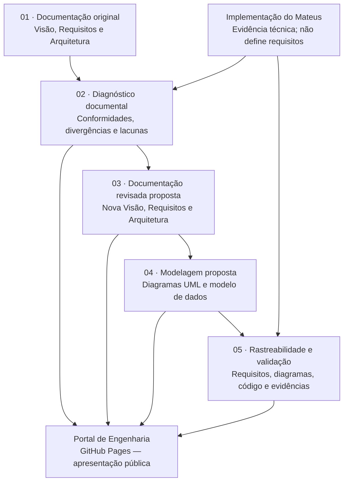

# VetCare — Engenharia de Software

> **Documento orientador do repositório.** Em caso de dúvida sobre escopo, prioridades ou sequência das atividades, retornar a este README antes de iniciar novos artefatos.

Este é um repositório **independente e complementar** ao projeto acadêmico **VetCare**, voltado à **análise de requisitos, diagnóstico documental, revisão de especificações, modelagem UML e rastreabilidade**. A Clínica **VetSPA** é o contexto de negócio descrito nos documentos originais.

**Objetivo atual:** produzir uma linha de base técnica coerente e rastreável para o VetCare. **Não é objetivo atual desenvolver um novo sistema, um fork ou o laboratório demonstrativo.**

## 1. Referências e princípios

### Fontes de referência

- **Documentação acadêmica original (preservada):**
  1. Documento de Visão — 10/06/2026.
  2. Documento de Requisitos de Software — 18/06/2026.
  3. Documento de Arquitetura de Software — versão 4.0, 28/06/2026.
- **Implementação existente, usada como evidência técnica:** [Rozeti/ProjetoVetCare](https://github.com/Rozeti/ProjetoVetCare).
- **Análises produzidas neste repositório:** documentos de trabalho, sujeitos a revisão e aprofundamento.

### Regras inegociáveis

1. **Não alterar os três PDFs originais.** Eles registram a linha de base histórica.
2. **Não tratar o código do Mateus como fonte automática de requisitos.** O código demonstra escolhas de implementação; mudanças de escopo exigem decisão explícita.
3. **Não apresentar sugestões como requisitos aprovados.** Identificar claramente: _original_, _implementado_, _divergente_, _proposto_, _aprovado_ e _pendente de validação_.
4. **Não afirmar que algo funciona somente porque existe no código.** Análise estática, teste executado e aprovação são evidências distintas.
5. **Não inventar critérios, diagramas, regras ou funcionalidades** para preencher lacunas. Registrar o que não foi definido.
6. **Preservar rastreabilidade:** todo item revisado deve apontar para sua origem e justificativa.
7. **Não iniciar o Lab ou a Demo** enquanto esta etapa documental estiver em andamento, salvo decisão explícita de mudança de escopo.

### Escopo vigente e mudanças

O DRS original especifica **16 histórias de usuário (HU-001 a HU-016), 11 regras de negócio (RN-001 a RN-011) e 8 requisitos não funcionais (RNF-001 a RNF-008)**.

Uma eventual **HU-017** ou outra funcionalidade encontrada no repositório de implementação **não entra automaticamente** na revisão: seu histórico e sua situação deverão ser investigados, pois há indicação de que a HU-017 deixou de integrar o escopo de trabalho. A decisão formal ainda deve ser registrada.

## 2. Fluxo oficial de trabalho



**Interpretação do fluxo:**

1. Conferir os documentos originais e o código existente, distinguindo os dois tipos de fonte.
2. **Diagnosticar** HU, RN, RNF, arquitetura e escopo: o que corresponde, diverge, falta ou excede os documentos.
3. Elaborar **três documentos completos revisados (propostos)** — Visão, Requisitos e Arquitetura — a partir do diagnóstico, sem sobrescrever os PDFs históricos. Divergências que dependem da equipe ficam assinaladas como pendentes, não resolvidas por suposição.
4. Construir os **novos diagramas** a partir dos documentos revisados, com casos de uso quando úteis, classes, sequência, atividades, componentes, implantação e modelos de dados conforme os requisitos acadêmicos. Não produzir um diagrama de cada tipo só para preencher pasta.
5. Fazer **rastreabilidade e diagnóstico de conformidade** entre requisitos revisados, modelagem e código do Mateus; reunir evidências com localização precisa.
6. Publicar no Portal as versões apropriadas para consulta, sem apresentá-las como formalmente aprovadas.

> O trabalho é **iterativo**: uma inconsistência descoberta na modelagem pode exigir voltar à documentação revisada. A ordem acima indica a dependência principal, não proíbe correções justificadas.

## 3. Primeira entrega prioritária

**`02-analise-documental/matriz-diagnostico-geral.md`**

Cobertura planejada: **HU-001–HU-016, RN-001–RN-011 e RNF-001–RNF-008**, além de mudanças ou funcionalidades extraescopo a investigar.

| Campo                      | Pergunta a responder                                                           |
| -------------------------- | ------------------------------------------------------------------------------ |
| ID e referência            | Qual HU/RN/RNF e em que seção/página do original?                              |
| Exigência original         | O que está efetivamente especificado?                                          |
| Evidência de implementação | Qual arquivo, classe, método ou configuração sustenta a comparação?            |
| Diagnóstico                | Conforme, parcial, divergente, não identificado, extraescopo ou pendente?      |
| Impacto                    | Qual risco, inconsistência ou dependência decorre da diferença?                |
| Recomendação               | Manter, esclarecer, corrigir, retirar do escopo proposto ou submeter à equipe? |
| Destino                    | Em qual documento revisado/diagrama a decisão terá reflexo?                    |
| Validação                  | Houve só leitura de código ou também teste executado?                          |

**Cuidado:** “não identificado” não significa “não implementado”; “conforme na inspeção” não equivale a “testado e aprovado”.

## 4. Organização do repositório

### Estrutura atual e evolução prevista

A reorganização será **incremental** para preservar links, commits e análises existentes. Os nomes abaixo representam a **estrutura-alvo**, não pastas já criadas:

```text
vetcare-engenharia-software/
├── README.md                         # Este documento orientador
├── index.html                        # Futuro Portal de Engenharia
├── assets/                           # Recursos estáticos do portal
├── 01-documentacao-original/         # PDFs históricos, sem alteração
├── 02-analise-documental/            # Comparações e matriz de diagnóstico
├── 03-documentacao-revisada/         # Nova Visão, Requisitos e Arquitetura (proposta)
├── 04-modelagem/                     # UML + modelagem de banco de dados
│   ├── casos-de-uso/
│   ├── classes/
│   ├── sequencia/
│   ├── atividades/
│   ├── componentes/
│   ├── implantacao/
│   └── banco-de-dados/
├── 05-rastreabilidade/               # Referências cruzadas e evidências
├── 06-validacao/                     # Critérios e testes, conforme prioridade
└── 07-laboratorio-web/               # Legado preservado; fora do foco atual
```

**Pastas atualmente existentes** (antes da reorganização): `01-documentacao/`, `02-analise-documental/`, `03-rastreabilidade/`, `04-diagramas/`, `05-testes/` e `07-laboratorio-web/`. Não renomear ou apagar tudo de uma vez: atualizar links e referências em cada mudança.

## 5. Portal de Engenharia — GitHub Pages

O Portal será **uma página pública de navegação pelos artefatos**, e **não uma Demo funcional do sistema VetCare**. A apresentação prevista terá:

| Seção do portal         | Conteúdo                                                                 |
| ----------------------- | ------------------------------------------------------------------------ |
| Documentação original   | Visão, Requisitos e Arquitetura, preservados                             |
| Análises e diagnósticos | Comparações, matriz de lacunas e recomendações                           |
| Documentação revisada   | Novos documentos propostos, com versão e status                          |
| Modelagem               | Casos de uso, UML e modelagem conceitual/lógica de dados                 |
| Rastreabilidade         | Ligações entre requisitos, diagramas, código e evidências                |
| Validação               | Critérios de aceite, casos de teste e resultados efetivamente executados |

**Publicação:** quando implementado, `index.html` será a entrada do Portal no GitHub Pages. O `README.md` continua sendo a apresentação do repositório na interface do GitHub. Não é necessário que o Portal dependa do sistema C# ou de PostgreSQL.

## 6. Convenções para os novos documentos

Cada documento revisado deve informar:

- **Título, versão, data, status** (_proposta / em revisão / aprovada_), autores e revisores.
- **Linha de base original** e referências às evidências de diagnóstico.
- **Mudanças propostas e justificativas**, preferencialmente em registro de decisões.
- **Pendências de negócio e técnica** que exigem validação da equipe/professor.
- **Impactos** em HU/RN/RNF, diagramas e modelo de dados.

### Rastreabilidade mínima

```text
Fonte original → Diagnóstico → Decisão registrada → Documento revisado
             → Diagrama/modelo → Código/evidência → Validação
```

A implementação do Mateus será comparada à documentação e aos modelos; **não será usada para reescrever silenciosamente o escopo**.

## 7. Política de branches, commits e mudanças

- **`main`:** documentação estável e entregas revisadas.
- **Branches de trabalho:** cada investigação, revisão ou portal poderá ter branch própria e PR para a `main`.
- **`feat/vetcare-lab-v2`:** branch anterior, preservada, mas sem prioridade e sem merge automático.
- **Commits pequenos e descritivos:** `docs: ...`, `refactor: ...` (somente quando necessário), `feat: ...` (Portal).
- **Antes de cada merge:** revisar arquivos afetados, links, status dos artefatos e a coerência com este README.

## 8. Critério para saber se estamos seguindo o plano

Antes de iniciar uma atividade, responder:

1. Ela contribui para **diagnóstico, documentação revisada, modelagem, rastreabilidade ou Portal**?
2. Está claro **qual fonte original** fundamenta a mudança?
3. Há evidência identificada do código — ou a análise está marcada como pendente?
4. Alguma proposta foi confundida com requisito aprovado?
5. Estamos tentando **implementar Lab/Demo sem necessidade**?
6. O resultado será colocado na **pasta correta**, sem criar arquivos duplicados?

Se houver desvio de escopo, **retomar este README**, registrar a nova decisão e só então alterar o plano.

---

**Estado do projeto:** planejamento da reorganização aprovado como direção de trabalho; matriz geral ainda é a próxima entrega. Os documentos originais permanecem preservados. O Portal, os documentos revisados e a nova modelagem ainda serão elaborados.
